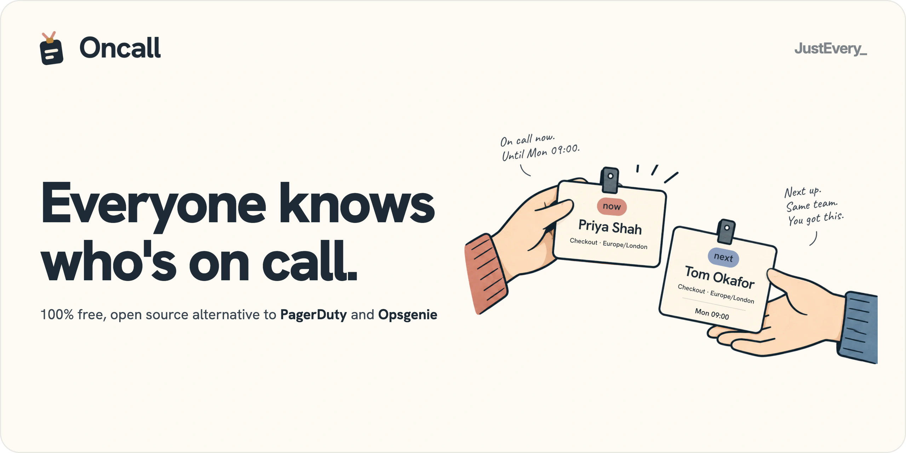
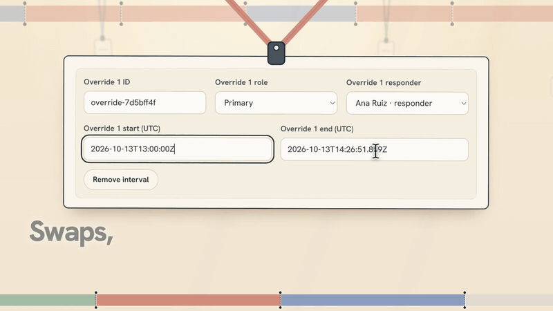
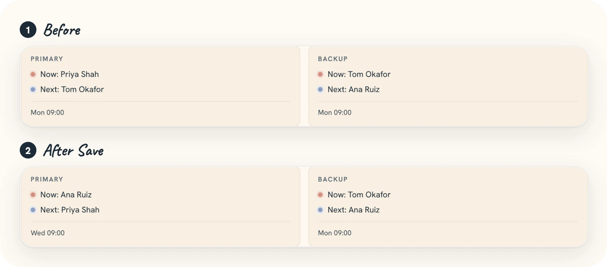
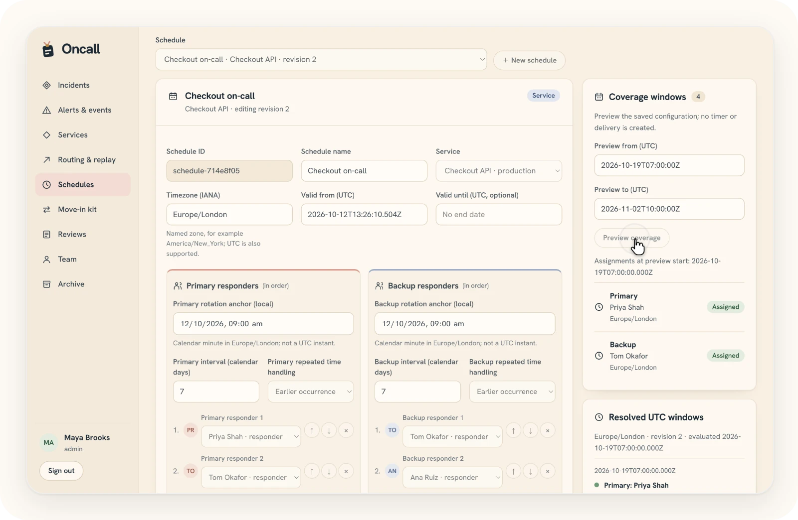
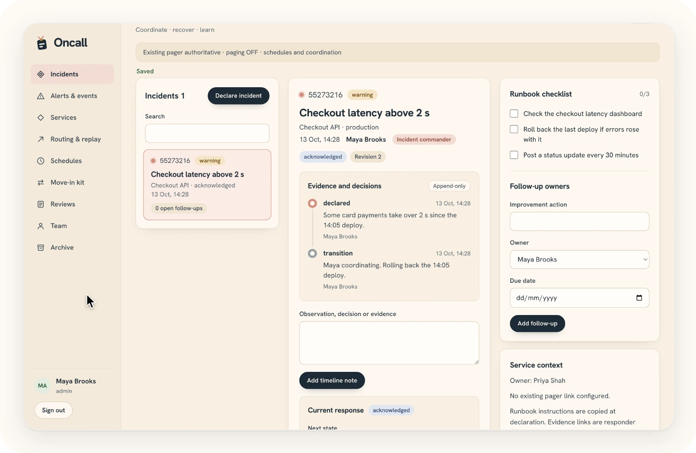

Rotas, alerts and incident notes for your team. Works beside your pager.

<p align="center">
  <a href="https://run-oncall.com">
    <picture>
      <source media="(prefers-color-scheme: dark)" srcset=".github/assets/banner-dark.webp">
      <source media="(prefers-color-scheme: light)" srcset=".github/assets/banner-light.webp">
      
    </picture>
  </a>
</p>

<p align="center"><a href="https://run-oncall.com">run-oncall.com</a> · <a href="https://justevery.com">Part of Just Every</a> · <a href="LICENSE">MIT licensed</a></p>

<p align="center">
  <a href="https://justevery.com/#vol-oncall"></a>
</p>
<p align="center"><a href="https://justevery.com/#vol-oncall"><b>Watch the full demo</b></a> · 54 seconds</p>

<p align="center">
  
</p>

<p align="center">
  <br>
  <sub>Rotations in your own time zone, with coverage previewed before you save.</sub>
</p>

<p align="center">
  <br>
  <sub>A calm place to coordinate an incident, with an append-only record.</sub>
</p>

# Run it locally

See the [Oncall Run page](https://run-oncall.com/run) for local launch and PATH help. Public source: [just-every/run-oncall](https://github.com/just-every/run-oncall). The current release supports hosted coordination. See [Getting started](docs/getting-started.md#host-for-your-team) for complete credentials and deployment instructions.

You need Git on macOS, Linux or Windows with WSL2. The installer provides Node and pnpm.

1. Install the `rer` command.

   ```sh
   curl -fsSL https://runeditrun.com/install.sh | sh
   ```

   The installer puts `rer` in `~/.local/bin`. If that directory is missing from your PATH, run `export PATH="$HOME/.local/bin:$PATH"` in Bash or Zsh. For a setup that also works in future terminals, or for a different shell, run `"$HOME/.local/bin/rer" cli path` and follow the printed instructions.

2. Clone the [latest published release](https://github.com/just-every/run-oncall/releases/latest) and start Oncall. If you already have an Oncall checkout, follow the [update steps](#later-updates).

   ```sh
   ONCALL_TAG=$(curl -fsS -o /dev/null -w '%{redirect_url}\n' https://github.com/just-every/run-oncall/releases/latest | sed -nE 's|^.*/releases/tag/(v[0-9]+\.[0-9]+\.[0-9]+)$|\1|p') && test -n "$ONCALL_TAG" &&
   mkdir run-oncall && cd run-oncall && git init -q &&
   git remote add origin https://github.com/just-every/run-oncall &&
   git fetch --quiet --depth 1 origin tag "$ONCALL_TAG" &&
   git checkout --quiet --detach "refs/tags/$ONCALL_TAG" &&
   "$HOME/.local/bin/rer" dev --host localhost
   ```

**Alternative for Node 22 or later.** Skip step 1 and use `npx -y @runeditrun/rer` in place of `"$HOME/.local/bin/rer"` in any example below.

If you used the installer, restart with `cd run-oncall && "$HOME/.local/bin/rer" dev`. If you used the Node alternative, restart with `cd run-oncall && npx -y @runeditrun/rer dev`. `rer dev` installs the application dependencies, creates a local development owner and prints a private link that opens Oncall signed in. On first launch, review the owner details and select **Finish setup**. Later launches open the app directly. To choose your own owner mailbox before the first launch, use [explicit setup](docs/getting-started.md#explicit-and-unattended-setup), which also accepts a private answers file for unattended runs. Once setup returns, use the restart command from inside the checkout and open its private `RER_OPEN` link.

After the first start, check the install with one schedule that has the owner on it: add a service under **Settings → Services**, choose **On call → New rota**, keep the owner as the primary person, set **Starts** to a time that has already passed and choose **Create rota**. **On call** then shows the owner as on call now. Known accessibility gap: below 900 px wide, including 390 px, the side rail is hidden and the installation name shows in the top bar, which is a plain `div` with no landmark role, so a screen reader cannot jump to it by landmark.

On a busy Mac, the first local start can take several minutes. `rer dev` prints progress every 20 seconds. Open the printed link on this computer. After setup, open your account menu and choose **Sign-in settings → Enroll passkey**. See [local passkey setup](docs/getting-started.md#sign-in-with-a-local-passkey). `"$HOME/.local/bin/rer" dev --as signed-out` selects the signed-out persona. The compatibility flag `"$HOME/.local/bin/rer" dev --login` still opens automatic owner entry. Ordinary `/signin` email sign-in sends only through a configured remote mail provider with real credentials; no sender is configured by default. The app does not capture mail or print sign-in tokens. Stop the background server with `"$HOME/.local/bin/rer" dev --stop` (Ctrl-C also stops a foreground run); stop preview with `"$HOME/.local/bin/rer" preview --stop` before building, verifying or deploying. A running dev or preview server owns the local state, so even a deploy dry run refuses with exit 4 until it stops.

```sh
"$HOME/.local/bin/rer" build
"$HOME/.local/bin/rer" preview
"$HOME/.local/bin/rer" verify
"$HOME/.local/bin/rer" export --output exports/installation.rer
"$HOME/.local/bin/rer" import --input exports/installation.rer --yes
"$HOME/.local/bin/rer" reset --yes
"$HOME/.local/bin/rer" dev --stop
"$HOME/.local/bin/rer" preview --stop
"$HOME/.local/bin/rer" deploy --environment production --dry-run
"$HOME/.local/bin/rer" describe
"$HOME/.local/bin/rer" check
```

Before the first `rer verify`, stop dev and preview, then install its browser using the dependencies `rer dev` (or `rer install`) already installed:

```sh
"$HOME/.local/bin/rer" run --script node_modules/@playwright/test/cli.js install chromium
"$HOME/.local/bin/rer" verify
```

This command uses the installer’s private Node runtime; no global Node or pnpm is needed. On Linux, add `--with-deps` to the browser install command if system libraries are missing. `rer doctor` reports a missing verification browser. `rer check` is silent on success (exit 0); `"$HOME/.local/bin/rer" check --json` prints the result.

Export includes supported durable records and the import journal, excluding sessions and dev credentials. Import requires an empty destination and explicit confirmation. If it refuses with `target_not_empty`, export any data you need to keep, stop dev and preview, then run `"$HOME/.local/bin/rer" reset --yes` before importing into the now-empty installation. Configure a new owner, sign in, then explicitly map an archived administrator identity from the signed-out workspace; credentials never travel. Reset deletes local data and owner settings and keeps your exports; see [Export and restore](docs/data.md) for the in-place restore sequence.

A deploy dry run builds and validates the local deployment plan. With no env file or Cloudflare credentials, a valid local plan exits 0: it sends nothing to Cloudflare, changes nothing remotely and checks no target secrets, deployment permissions or remote readiness. Adding `--env-file` to a dry run does not enable remote checks. For those checks, prepare the private credentials file and run the real deployment described in [Host for your team](#host-for-your-team); it creates or updates hosted resources. Email delivery needs the separate sign-in test below.

Release 1 supports hosted incident coordination alongside your existing pager. Paging stays OFF; an independent standby is not required for coordination. Release 2 paging and its independent standby are not built. See [hosting instructions](docs/getting-started.md#host-for-your-team) for deployment, sign-in and removal. Use `describe` for flags and `doctor` for missing local prerequisites.

Oncall keeps rotas, schedules, overrides, incident coordination and recorded alert intake beside your existing pager. The existing pager stays authoritative. Text-message paging is an optional sender that is off by default; it needs a Twilio sender declared at deploy time and an administrator's switch on a rota (see [paging](docs/paging.md)). No voice, push or paging email is sent, and the other delivery adapters refuse plainly. To connect monitoring, see the [alert intake JSON and curl example](docs/incidents.md#send-an-alert-event).

Schedules use named IANA zones, calendar-day turns, explicit repeated-time rules and half-open UTC overrides. Inspect who is on call now and at the next hand-off, download a private seven-day ICS feed, and store primary/backup escalation delays as data. Coverage gaps remain visible.

Move in (under Settings) reviews supplied Opsgenie exports first, then PagerDuty. Preview writes nothing; confirmed imports stay paused and grant no access or delivery authority. A durable Base import-kit journal supports resume and guarded undo. Read [MOVE-IN.md](MOVE-IN.md) for documented export shapes and compatibility limits.

Held data upgrades in place through unchanged migrations 0001–0006 and additive migrations. Coordination now stores individual members, services, policies, events, alerts, incidents and audit entries in relational tables. Old password accounts remain usable; Base owner identity never silently takes over an existing workspace. For a held installation, continue using its password accounts until the owner explicitly links identity during a future identity migration. On local and hosted apps, the configured owner uses email links and admin-created team members use their installation-local workspace name and password at `/signin/local`. Only anonymous first-admin bootstrap remains loopback-only. Do not reset to upgrade.

To look around with realistic sample data, run `"$HOME/.local/bin/rer" demo` after setup: a throwaway, signed-in copy where nothing can page, call, text or email ([DEMO.md](DEMO.md)).

Read [CONTRACT.md](CONTRACT.md), [ACCEPTANCE.md](ACCEPTANCE.md), [OPERATIONS.md](OPERATIONS.md) and [RELEASE.md](RELEASE.md). The checkout declares its exact command version in `package.json` and the lockfile. `base-copies.json` records each Base runtime/module copy and its own revision; `src/base` comes from Base 6d38b54a6401879989e8d1f7ab4a02ffbdb4c46c. Source locks are generated with Base's edition-authoring command from this checkout. This repository is runnable source, without a composition step.

## Update, host and remove

### Later updates

From your existing checkout, stop the local servers and switch to the latest published release.

```sh
"$HOME/.local/bin/rer" dev --stop
"$HOME/.local/bin/rer" preview --stop
ONCALL_TAG=$(curl -fsS -o /dev/null -w '%{redirect_url}\n' https://github.com/just-every/run-oncall/releases/latest | sed -nE 's|^.*/releases/tag/(v[0-9]+\.[0-9]+\.[0-9]+)$|\1|p') && test -n "$ONCALL_TAG" &&
git fetch --depth 1 origin tag "$ONCALL_TAG" &&
git checkout --detach "refs/tags/$ONCALL_TAG" &&
"$HOME/.local/bin/rer" dev --host localhost
```

This restarts the updated local app, applies migrations and keeps your owner, schedules and incidents. `rer` uses the new checkout's pinned toolchain. If the saved port is in use, run the `"$HOME/.local/bin/rer" setup --port N` command printed in the error, then restart.

### From 0.1.0

Stop the old servers before switching releases. 0.1.0 uses the checkout's runner, which the update removes.

```sh
node scripts/rer.mjs dev --stop
node scripts/rer.mjs preview --stop
```

Then use [Later updates](#later-updates). Use the installer or Node alternative above.

The update applies Oncall's additive migrations. Your data, owner and password accounts are kept; people who sign in with a workspace password sign in once more after updating to 0.3.0. Do not reset to upgrade.

### Host for your team

Hosting is in `v0.3.0` and later. Release 1 hosts coordination alongside your existing pager, with paging OFF and no standby requirement. Follow [Getting started](docs/getting-started.md#host-for-your-team) to set up the owner and save your Cloudflare account ID and API token in an owner-only `0600` file outside Git.

Mail is optional. Choose how the owner will sign in and set it in the same deploy file:

1. **With email off**, set `MAIL_PROVIDER=none` and leave the sender and mail credentials unset. The deploying owner signs in with `rer signin`.
2. **With email links**, configure [SendGrid and a verified sender](docs/getting-started.md#get-a-sendgrid-key-and-verified-sender-for-email-links). Set `MAIL_PROVIDER=sendgrid`, `SENDGRID_API_KEY` and `MAIL_FROM`. The owner can then request an emailed sign-in link.

Use `MAIL_PROVIDER=development` for local `rer setup`. It prints `RER_SETUP_READY` with a loopback address and stops its temporary app. For local access on `localhost`, run `"$HOME/.local/bin/rer" setup --host localhost` once (setup keeps the saved host), then `"$HOME/.local/bin/rer" dev`, and open the private `RER_OPEN` link it prints. For hosting, continue with deployment below.

If a server is running in the hosting checkout, stop it with `"$HOME/.local/bin/rer" dev --stop` for development or `"$HOME/.local/bin/rer" preview --stop` for preview. Ctrl-C also stops a foreground server. With the private file prepared as described there:

```sh
"$HOME/.local/bin/rer" deploy --environment production --env-file "$HOME/.config/oncall/production.env" --dry-run
"$HOME/.local/bin/rer" deploy --environment production --env-file "$HOME/.config/oncall/production.env"
```

The dry run validates the local plan even with the private file. The real command uses the Cloudflare credentials and the chosen mail settings from that file to check the target and deploy.

Use the same named environment for every later command. It defaults to `production`. Deployment creates the hosted installation, applies migrations, verifies deployment identity, claims the configured owner automatically and retires its one-time setup token.

**With email off**, run this from the deploying checkout with the same Cloudflare credentials:

```sh
"$HOME/.local/bin/rer" signin --environment production --env-file "$HOME/.config/oncall/production.env"
```

`rer signin` prints a one-time sign-in notice, then the private URL on its own line with no `RER_OPEN` prefix. Open it privately within 15 minutes and press **Confirm**. For Business agent setup, pass only that URL as `sign_in` in `session.report`. Keep it out of chat and files.

**With email links**, open the deployed address and press **Email a sign-in link**. Open the received link on the same device and press **Confirm**. The same `rer signin` command also works for owner recovery.

Finish the owner confirmation at `/setup` if shown. Admin-created team members use their workspace name and password at `/signin/local`. Oncall sends no invitations.

Deployment uses a separate hosted database; it does not upload local schedules or incidents. Keep this checkout's `.rer/deploy/` records. For later hosted updates, switch to the latest published release and deploy to the same environment.

```sh
ONCALL_TAG=$(curl -fsS -o /dev/null -w '%{redirect_url}\n' https://github.com/just-every/run-oncall/releases/latest | sed -nE 's|^.*/releases/tag/(v[0-9]+\.[0-9]+\.[0-9]+)$|\1|p') && test -n "$ONCALL_TAG" &&
git fetch --depth 1 origin tag "$ONCALL_TAG" &&
git checkout --detach "refs/tags/$ONCALL_TAG" &&
"$HOME/.local/bin/rer" deploy --environment production --env-file "$HOME/.config/oncall/production.env"
```

Updates keep the hosted owner and data. Existing hosted secrets are retained; [Getting started](docs/getting-started.md#update-a-hosted-installation) explains explicit mail-key and sender changes.

To remove the hosted installation and its database, keep its deployment records and use the same Cloudflare credentials and environment:

```sh
"$HOME/.local/bin/rer" deploy --environment production --env-file "$HOME/.config/oncall/production.env" --remove --yes
```

Removal deletes only recorded resources created by this deployment and verifies each is absent. Your local folder and data stay.
