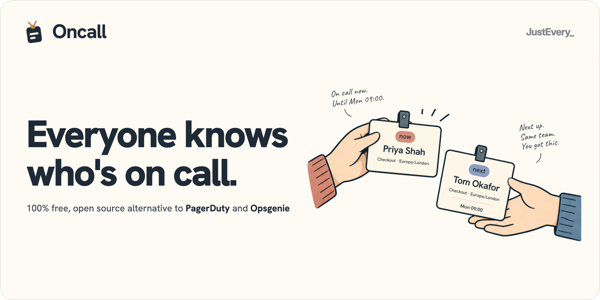
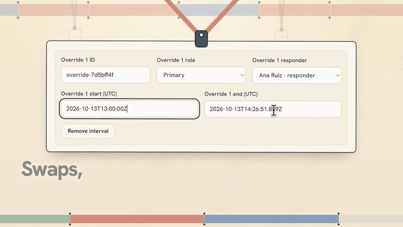
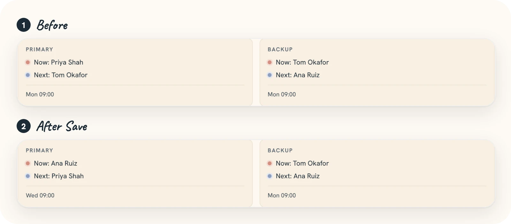
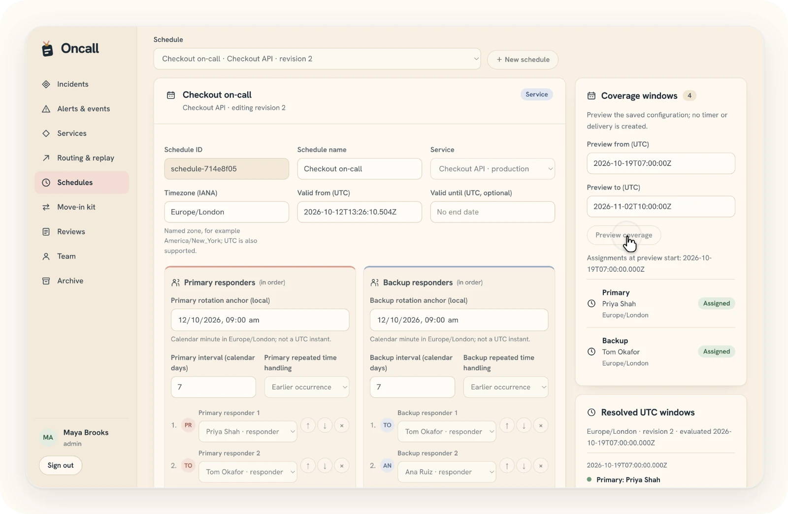
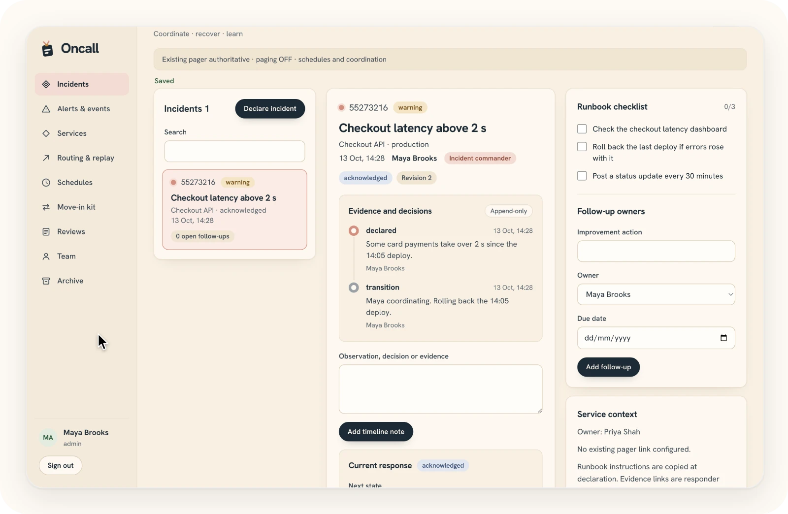

<p align="center">
  <a href="https://run-oncall.com">
    <picture>
      <source media="(prefers-color-scheme: dark)" srcset=".github/assets/banner-dark.webp">
      <source media="(prefers-color-scheme: light)" srcset=".github/assets/banner-light.webp">
      
    </picture>
  </a>
</p>

<p align="center"><a href="https://run-oncall.com">run-oncall.com</a> · <a href="https://justevery.com">Part of Just Every</a> · <a href="LICENSE">MIT licensed</a></p>

<p align="center">
  <a href="https://justevery.com/#vol-oncall"></a>
</p>
<p align="center"><a href="https://justevery.com/#vol-oncall"><b>Watch the full demo</b></a> · 54 seconds</p>

<p align="center">
  
</p>

<p align="center">
  <br>
  <sub>Rotations in your own time zone, with coverage previewed before you save.</sub>
</p>

<p align="center">
  <br>
  <sub>A calm place to coordinate an incident, with an append-only record.</sub>
</p>

# Run it locally

Public source: [just-every/run-oncall](https://github.com/just-every/run-oncall), release 0.2.0.

Install the `rer` command once:

```sh
curl -fsSL https://runeditrun.com/install.sh | sh
```

Or use `npm install -g @runeditrun/rer`. You need Git and Node 22 or later, on macOS, Linux or Windows with WSL2; `rer` provides the checkout's pinned Node and pnpm tooling.

```sh
git clone https://github.com/just-every/run-oncall.git oncall
cd oncall
rer dev
```

`rer dev` installs the application dependencies, creates a local development owner and prints a private `RER_OPEN` link that opens Oncall signed in. On first launch, confirm the read-only owner details at **Finish setup**. To choose your own owner mailbox before the first launch, use [explicit setup](docs/install.md#explicit-and-unattended-setup); unattended setup accepts a private answers file.

Open the printed link on this computer. Email links appear in the key-gated local outbox; no external email is sent. For ordinary sign-in, use `rer dev --as signed-out` or `rer dev --login` and open the printed link first so the browser can access the outbox. Stop the background server with `rer dev --stop` (Ctrl-C also stops a foreground run); stop preview with `rer preview --stop` before building or verifying.

```sh
rer build
rer preview
rer verify
rer export --output exports/installation.rer
rer import --input exports/installation.rer --yes
rer reset --yes
rer deploy --dry-run
rer describe
rer check
```

Before the first `rer verify`, stop dev and preview, then install its browser using the dependencies `rer dev` (or `rer install`) already installed:

```sh
node node_modules/@playwright/test/cli.js install chromium
rer verify
```

This command uses Node directly; no global pnpm is needed. On Linux, add `--with-deps` to the browser install command if system libraries are missing. `rer doctor` reports a missing verification browser and prints this command. `rer check` is silent on success (exit 0); `rer check --json` prints the result.

Export includes supported durable records and the import journal, excluding sessions and dev credentials. Import requires an empty destination and explicit confirmation. If it refuses with `target_not_empty`, export any data you need to keep, stop dev and preview, then run `rer reset --yes` before importing into the now-empty installation. Configure a new owner, sign in, then explicitly map an archived administrator identity from the signed-out workspace; credentials never travel. Reset deletes local data and owner settings. A deploy dry run builds and validates locally without provider requests. Hosted Oncall is on hold until an independent standby paging host is ready and a hosted release is approved. Until then, `rer deploy` refuses before any provider request. Paging remains OFF until a real-phone drill passes as well. Use `describe` for flags and `doctor` for missing local prerequisites.

Oncall keeps rotas, schedules, overrides, incident coordination and recorded alert intake beside your existing pager. The existing pager stays authoritative. No SMS, voice, push or paging email is sent. The delivery adapter refuses plainly. To connect monitoring, see the [alert intake JSON and curl example](docs/incidents.md#send-an-alert-event).

Schedules use named IANA zones, calendar-day turns, explicit repeated-time rules and half-open UTC overrides. Inspect who is on call now and at the next hand-off, download a private seven-day ICS feed, and store primary/backup escalation delays as data. Coverage gaps remain visible.

The Move-in kit reviews supplied Opsgenie exports first, then PagerDuty. Preview writes nothing; confirmed imports stay paused and grant no access or delivery authority. A durable Base import-kit journal supports resume and guarded undo. Read [MOVE-IN.md](MOVE-IN.md) for documented export shapes and compatibility limits.

Held data upgrades in place through unchanged migrations 0001–0006 and additive migrations. Coordination now stores individual members, services, policies, events, alerts, incidents and audit entries in relational tables. Old password accounts remain usable; Base owner identity never silently takes over an existing workspace. For a held installation, continue using its password accounts until the owner explicitly links identity during a future identity migration. Do not reset to upgrade.

To look around with realistic sample data, run `rer demo` after setup: a throwaway, signed-in copy where nothing can page, call, text or email ([DEMO.md](DEMO.md)).

Read [CONTRACT.md](CONTRACT.md), [ACCEPTANCE.md](ACCEPTANCE.md), [OPERATIONS.md](OPERATIONS.md) and [RELEASE.md](RELEASE.md). The checkout declares its exact command version in `package.json` and the lockfile. `base-copies.json` records each Base runtime/module copy and its own revision; `src/base` comes from Base 8981bc2c4d9e61feca5787c83b4ed44056659dd9. Source locks are generated with Base's edition-authoring command from this checkout. This repository is runnable source, without a composition step.

## Update, host and remove

### From 0.1.0

Stop the old servers **before pulling**: 0.1.0 uses the checkout's runner, which the update removes.

```sh
node scripts/rer.mjs dev --stop
node scripts/rer.mjs preview --stop
```

Install the `rer` command once, while you still have the old checkout:

```sh
curl -fsSL https://runeditrun.com/install.sh | sh
```

Open a new terminal if the installer asks you to, or use `npm install -g @runeditrun/rer`. Then, from this checkout on `main`:

```sh
git pull --ff-only
rer dev
```

There are no new migrations in 0.2.0. Your data, owner and password accounts are kept. Do not reset to upgrade.

### Later updates

Update this checkout without resetting its data:

```sh
rer dev --stop
rer preview --stop
git pull --ff-only
rer dev
```

This restarts the updated local app, applies migrations and keeps your owner, schedules and incidents. No hosted deployment is needed. `rer` installs a pulled change of its own pin before it runs, so there is nothing to install by hand, and it provides the Node and pnpm versions this checkout pins. Hosted Oncall is on hold until an independent standby paging host is ready and a hosted release is approved. Until then, `rer deploy` refuses before any provider request. Paging stays OFF until a real-phone drill passes. Use `rer deploy --dry-run` to build and validate locally. Once hosting is approved, `rer deploy` deploys to your own Cloudflare account (it reads `CLOUDFLARE_ACCOUNT_ID` and `CLOUDFLARE_API_TOKEN` from the environment), claims the owner you set up automatically and removes its one-time setup token; there is no token to copy or delete, and you sign in at the app address with an emailed link. An update keeps that owner. To take a hosted installation down again, with the same credentials:

```sh
rer deploy --remove --yes
```

This deletes only what the deployment record says `rer deploy` created (the Worker, database and any queues), reads back that each is gone and touches nothing else. Your local folder and data stay.
